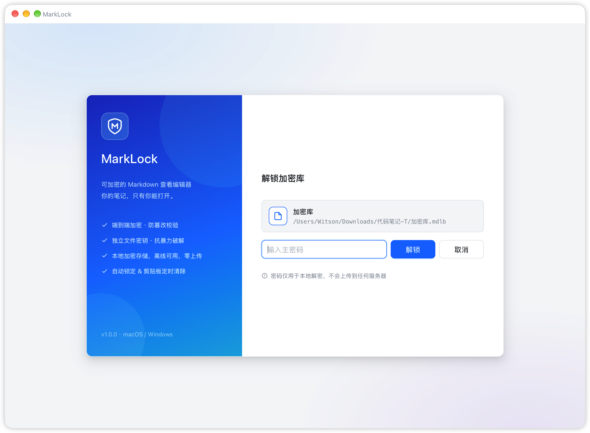
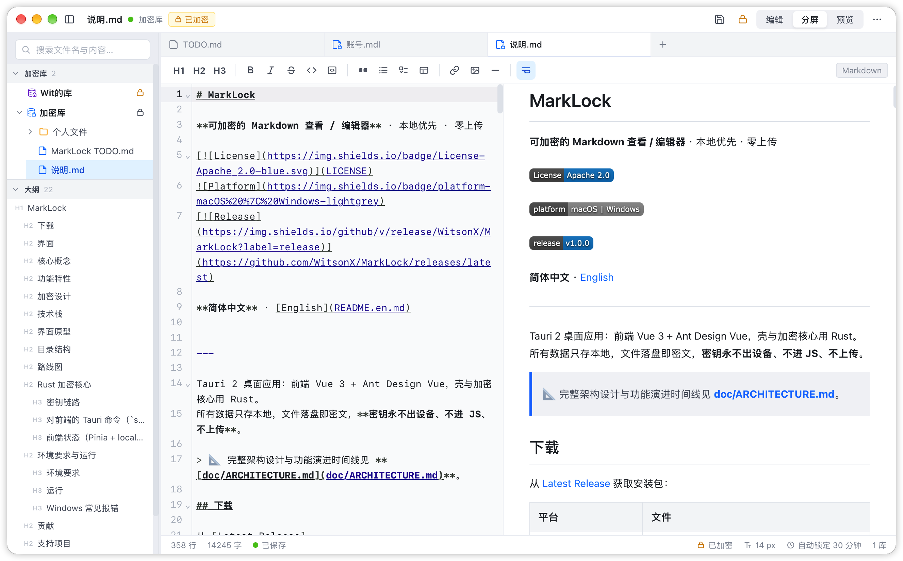
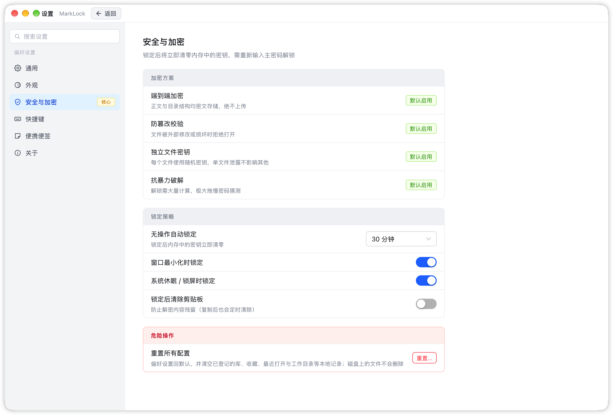
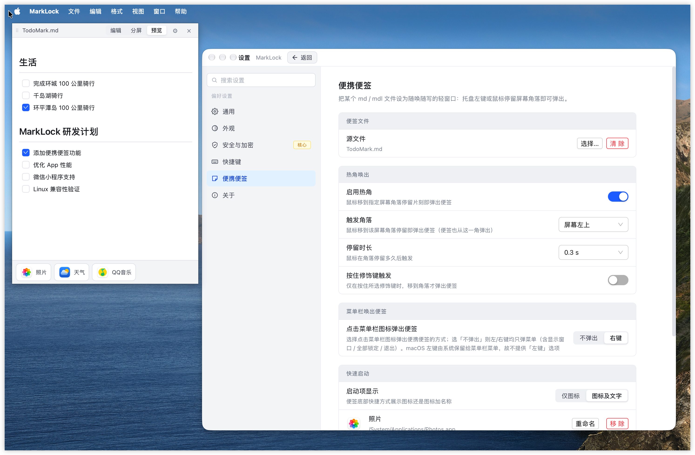

# MarkLock

**可加密的 Markdown 查看 / 编辑器** · 本地优先 · 零上传

[](LICENSE)

[](https://github.com/WitsonX/MarkLock/releases/latest)

**简体中文** · [English](README.en.md)

---

一个装在自己电脑上的 Markdown 工具：像普通编辑器一样读写 md，但**落盘即密文**。笔记、账目、方案这类不想让别人翻到的内容，可以整库加密存成一个文件带走；不想加密的日常笔记照旧当 md 用。

密钥全部在 Rust 侧运算，**不出设备、不进 JS、不上传**——没有账号，没有云，没有任何联网请求参与加解密。

## 为什么选它

- **库就是一个文件**：整棵目录树（含文件名、文件夹名）加密成一个 `.mdlb`，可以直接丢进 iCloud / Dropbox / 移动硬盘同步，别人打开只能看到一团密文。
- **图片也是密文**：往加密笔记里粘贴或拖入的图片、附件，落盘就是一团团密文容器，磁盘上不留明文；解锁后才解密到应用缓存供预览，改主密码时它们跟着正文一起换锁。
- **改密码不用重加密**：主密码只用来包裹数据密钥，换密码瞬间完成，百万字大库也不卡。
- **锁定即失忆**：无操作超时、锁屏、休眠都会清零内存里的密钥；已打开的库内文件页签变成「xx 库文件」，连文件名都不外露。
- **轻**：Windows 安装包默认 3.5MB，macOS 单文件几十 MB，用系统 WebView，不是打包一个浏览器。
- **随手一贴**：便携便签把一个 md / mdl 文件挂在屏幕角落或托盘上，鼠标移过去即写即存，写的还是加密内容。
- **开源可审**：Apache-2.0，加密核心全部有单元测试，欢迎读源码验证上面每句话。

## 下载

从 [Latest Release](https://github.com/WitsonX/MarkLock/releases/latest) 获取安装包，文件名按平台选即可；国内网络可改从 [Gitee 发行版](https://gitee.com/Witson/MarkLock/releases) 下载（Gitee 有除离线包外的全部安装包）。

- 默认 Windows 包只有 3.5MB（WebView2 运行时安装时联网下载）；机器没有 WebView2 又连不上微软 CDN 时，改用 `*-setup-offline.exe`（约 209MB，全程免网）。Win11 和更新过的 Win10 一般自带运行时，用默认包就够。
- 离线包只在 GitHub 提供（Gitee 附件单文件限 100MB）；Gitee 侧可先装官方 [WebView2 运行时](https://go.microsoft.com/fwlink/?linkid=2124701) 再装小包。
- **绿色版**：想直接用最领先的构建，去 [canary 发行页](https://github.com/WitsonX/MarkLock/releases/tag/canary) 拿免安装包（macOS 解压即用的 `.app`，Windows 解压直接跑的 `.exe`）。每次推 master 自动重出，包名固定不用挑版本，「关于」里会标出 `Canary <commit>`；只在 GitHub 提供，且跟的是未发布主线，求稳仍建议用正式版。

> 安装包未走 Apple 公证，首次打开提示「Apple 无法验证」属固定流程，放行只需一次：弹窗点「完成」→「系统设置 → 隐私与安全性 → 安全性」里点**「仍要打开」**→ 输密码，之后同一位置不再询问（部分版本右键 → 打开 也可）。若提示「已损坏」，是旧构建未做资源密封，执行 `xattr -dr com.apple.quarantine /Applications/MarkLock.app` 即可。Windows 同样未签名，SmartScreen 里点「更多信息 → 仍要运行」。

## 界面

**启动与解锁**



**主编辑器**（分屏预览 + 侧边栏库树）



**设置 → 安全与加密**



**便携便签**（左：便签轻窗口预览态 + 底部快速启动；右：设置 → 便携便签）



## 核心概念

| 概念 | 说明 |
|---|---|
| 加密库 `.mdlb` | 一个**单文件容器**（MarkLock Bundle），内部是一棵加密的文件树——文件名、目录结构、正文全部密文，磁盘上只有一个不透明的 `.mdlb` 文件，可整体放进 iCloud / Dropbox / 移动硬盘同步 |
| 加密文件 `.mdl` | 单个加密的 Markdown 文件（MarkDown Lock），也可独立存在（如桌面上的「投资记录.mdl」） |
| 附件目录 `<文档名>.dat` | 图片与附件不放进容器，而是与文档同级的独立加密容器（每个附件一把数据密钥，同样由主密码锁）；解锁后解密到应用缓存供预览，锁定或退出即清除 |
| 主密码 | 只存在于用户脑中，经 Argon2id 派生出 KEK，不落盘、不上传 |
| DEK | 库/文件的随机数据密钥，由 KEK 包裹后存于文件头；改主密码只需重包裹 DEK，无需全文重加密 |

## 功能

### 加密与库管理

- 新建 / 打开加密库，支持密码提示、最近列表、连续失败次数限制
- 库内任意层级嵌套文件夹，可新建、重命名、移动、删除；解锁一次后库内所有文件复用会话，不再重复输密码
- 单个 `.mdl` 文件独立密码，适合"就这一份要藏起来"
- 普通 `.md` 明文文件同样能打开编辑，右键一键**转为加密文件**（可选删除原明文）；也支持批量加密整个目录
- 修改主密码、更换加密方案（全文重加密）、明文导出（危险操作，二次确认）
- 粘贴或拖入 `.mdl` / 库内文件的图片与附件（zip、pdf 等也一样）以密文存进同级 `<文档名>.dat`，与正文共用同一把主密码锁；改密码会连附件一起重包裹，坏掉的某一张只跳过它自己，不会让整库图片一起消失

### 编辑与浏览

- CodeMirror 6 源码编辑，Markdown 语法高亮，编辑 / 分屏 / 预览三态，格式化工具栏
- 自动保存（800ms 防抖加密落盘），可关
- 全文搜索（解密只在内存中进行）、大纲跳转、收藏、导出 HTML
- 导出的 HTML 会带上用到的附件：图片与非图片文件一并复制进 `<导出名>.dat/` 并改写为相对链接，成品发给别人也能直接看图；导出成功提示里可一键打开文件或所在文件夹
- 预览里点附件：文档类型直接开页签，zip / 图片 / pdf 等二进制改为弹保存对话框下载，不会按文本解析报错
- macOS 上被 iCloud 存成「仅在线」的文件，读写时自动召回下载并显示进度提示，等待不再表现为「读文件失败」
- VSCode 式侧边栏：打开的文件 / 打开的库 / 收藏 / 最近打开 / 工作目录，分组可排序、可显隐；多文件切换支持顶部页签或左侧列表
- 工作目录直接浏览本机文件树，库文件作为整体节点显示
- 外部修改监控：别的程序改写了你正打开的文件会及时重载；你有未保存编辑时只挂橙色角标，不会顶掉你的内容

### 便携便签

- 把某个 md / mdl 文件设为便签，托盘（macOS 为菜单栏）图标一点即弹出
- 也可用**屏幕热角**：鼠标移到指定角落停留片刻唤出，可要求按住修饰键才触发，避免路过误弹
- 编辑 / 分屏 / 预览一体，写完直接加密落盘；所在库锁定时便签内就能输密码解锁
- 底部可放一排本地应用快捷方式当快速启动，支持仅图标或图标加文字
- 笔记读不到时（明文文件读写失败、库内文件被移动）显示原因和「重试」，不再一律把你导向解锁页

### 安全与体验

- 无操作自动锁定（默认 5 分钟）、窗口最小化 / 系统休眠 / 锁屏时锁定，锁定时内存密钥清零、剪贴板 60 秒自动清除
- 库锁定后其文件页签与收藏、最近记录都显示为「xx 库文件」，不泄露真实文件名
- 皮肤系统：浅色 / 深色 / 跟随系统之外另有六套配色皮肤（蓝灰 Nord、夜蓝 Nocturne、卡布奇诺 Catppuccin、纸色 Sepia、日光 Solarized、暖棕 Gruvbox），状态栏一键切换；皮肤同时作用于界面、源码编辑器、Markdown 预览与导出的 HTML，高级用户还能自建皮肤（逐项色板 + 自由 CSS）
- 界面语言中英切换，编辑器字号、预览字体与间距可调
- 全套键盘快捷键：保存、页签导航（`⌘1…8` 直达第 N 个）、编辑器内搜索替换、全局搜索、视图三态切换、格式化、一键全部锁定
- 一键把 MarkLock 设为 `.md` / `.mdl` / `.mdlb` 的默认打开程序
- 开机自启动（可静默驻留后台），关闭窗口最小化到托盘
- 启动时恢复上次会话；按频率静默检查新版本，发现后一键前往发布页

## 技术文档

想弄清楚"为什么密文里连文件名都看不到""改密码为什么不重加密"，或者要跑起来改代码，看这里：

- **[doc/TECHNICAL.md](doc/TECHNICAL.md)** — 技术说明：磁盘格式与密钥链路、Rust 加密核心模块、Tauri 命令清单、便签与热角实现、开发环境与打包发布、Windows/ARM64 常见构建报错
- **[doc/ARCHITECTURE.md](doc/ARCHITECTURE.md)** — 架构设计与功能演进时间线
- **[doc/ui-prototype/](doc/ui-prototype/)** — 纯静态界面原型（无依赖，双击即看），组件拆分的视觉基准

以上两份文档均有英文版（[doc/TECHNICAL.en.md](doc/TECHNICAL.en.md)、[doc/ARCHITECTURE.en.md](doc/ARCHITECTURE.en.md)），中英同步维护。

一句话概括技术选型：**Tauri 2 壳 + Vue 3（Options API）+ Ant Design Vue + CodeMirror 6 前端，加密核心 Rust（`aes-gcm` + `argon2` + `zeroize`）**。选 Tauri 而不是 Electron，是为了小包体 + 系统 WebView + 能直接用 Rust 写加密。

## 快速上手

```bash
npm ci              # 安装前端依赖
npm run dev:tauri   # 前端 + Tauri 壳一起跑（需 Rust 环境）
npm run dev:app     # macOS 推荐：打包 debug 版并启动，托盘/便签功能可用
cd src-tauri && cargo test --lib   # 加密核心单元测试
```

环境要求（macOS 需 Xcode Command Line Tools；Windows 需 Rust + VS Build Tools 的「使用 C++ 的桌面开发」工作负载，缺一不可）与逐项排错见 [doc/TECHNICAL.md](doc/TECHNICAL.md#开发与调试)。

## 路线图

1.0 已覆盖加密库 / 单文件双形态、CodeMirror 编辑器、全文搜索、收藏、大纲、外部修改监控、便携便签与打包分发。

1.1 把「落盘即密文」延伸到图片与附件：正文之外，磁盘上同样不留明文。

需求与建议欢迎提到 [Issues](https://github.com/WitsonX/MarkLock/issues)。

## 贡献

欢迎提 Issue 与 PR。较大改动建议先开 Issue 讨论方向。

- 开发环境与运行方式见 [doc/TECHNICAL.md](doc/TECHNICAL.md#开发与调试)
- 前端组件统一使用 **Options API**（不使用 `<script setup>` / Composition API）
- 提交前请跑 `cargo test --lib`（在 `src-tauri/` 下）确认加密核心无回归

## 支持项目

MarkLock 免费且开源。如果它帮到了你：

- ⭐ Star 本仓库，让更多人发现它
- 🐛 提 Issue 反馈问题或建议功能
- ☕ 打赏支持作者持续维护

<!-- 捐赠二维码放入 doc/donate/ 后取消下方注释，占位说明见 doc/assets/README.md
| 微信赞赏 | 支付宝 |
|---|---|
|  |  |
-->

## 许可证

[Apache License 2.0](LICENSE)

## 致谢

- [Tauri](https://tauri.app/) — 轻量且安全的桌面壳
- [Vue](https://vuejs.org/) · [Ant Design Vue](https://antdv.com/) — 前端与组件
- [CodeMirror](https://codemirror.net/) — Markdown 编辑器
- [aes-gcm](https://github.com/RustCrypto/AEADs) · [argon2](https://github.com/RustCrypto/password-hashes) · [zeroize](https://github.com/RustCrypto/traits/tree/master/zeroize) — 加密原语与内存清零
